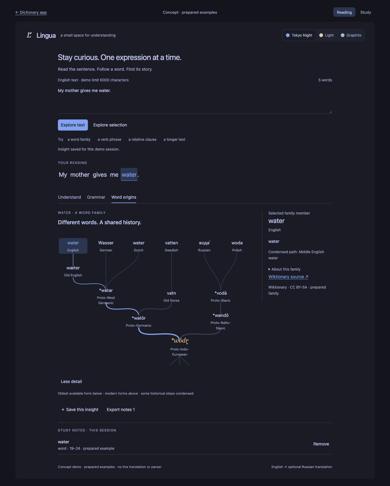

# Lingua

**Read a sentence. Understand a connection. Follow a word’s history.**

Lingua is a personal language exploration project built with TypeScript, React,
and Electron. The current application combines translation, dictionary lookup,
and etymological trees. A separate interactive concept explores the next step:
understanding selected words and expressions through meaning, grammar, and
source-backed word families.

[](https://github.com/Godsdar/lingua/actions/workflows/ci.yml)
[](https://github.com/Godsdar/lingua/actions/workflows/deploy-web.yml)
[](LICENSE)

**[Try the reading concept](https://godsdar.github.io/lingua/concept/)** ·
**[Open the dictionary app](https://godsdar.github.io/lingua/)** ·
[Product specification](docs/PRODUCT_SPEC.md) ·
[Architecture plan](docs/ARCHITECTURE_PLAN.md)



## Project status

Lingua is an early project for personal use, with a public demo for feedback.
The concept and the existing application have different capabilities:

| | Existing dictionary app | Reading concept |
|---|---|---|
| Translation | Live providers; availability and limits vary | Prepared English → Russian examples |
| Word analysis | Dictionary POS, glosses, alternatives | Prepared lemmas, grammatical features, dependencies |
| Etymology | Word/translation paths from Wiktionary | Curated `water` and `mother` families with sources |
| Reading workflow | Up to eight unique words in the current analysis | Select an occurrence or expression within longer text |
| Notes and sharing | Local roots collection, image export, permalinks | Session notes; Markdown, JSON, and HTML reports |
| Interface | Shared React/MUI application | Reading/Study layouts; Tokyo Night, Light, Graphite |

**The concept is not a live NLP service.** Three prepared sentences demonstrate
simple syntax, the present perfect progressive, and a relative clause. Other
text remains selectable, but receives no invented grammar, translation, or
etymology. Concept notes last for the current session and are cleared on reload.

## Explore the concept

1. Choose **a word family** and select `water` or `mother`.
2. Open **Word origins**, choose a historical form, and inspect its source.
3. Choose **a verb phrase** and select **has been reading**; switch between
   **Understand** and **Grammar**.
4. Choose **a longer text**, highlight an expression in the editor, and click
   **Explore selection**. Alternatively, click a word in the reading text.
5. Use **Save this insight → Export notes**. Preview an HTML report or download
   Markdown, JSON, or HTML with context, grammar, and available historical sources.

JSON reports use UTF-16 positions with an exclusive end index, matching
JavaScript strings. Repeated words retain separate occurrence ranges.
See [Concept documentation](docs/CONCEPT.md) for provenance and limitations.

## Run locally

Use **Node.js 24 or newer** and npm. Node’s built-in test runner executes the
TypeScript tests directly. No API key is required for the concept.

```sh
git clone https://github.com/Godsdar/lingua.git
cd lingua
npm ci
npm run dev:web
```

Open the URL printed by Vite for the dictionary app. Append `/concept/` for the
reading concept, for example `http://localhost:5173/concept/`.

For Electron development:

```sh
npm run dev
```

### Commands

| Command | Purpose |
|---|---|
| `npm test` | Run etymology-tree tests with Node’s test runner |
| `npm run typecheck` | Check main/preload and renderer TypeScript |
| `npm run dev:web` | Start the web development server |
| `npm run build:web` | Build the web app, including `/concept/`, into `web/dist` |
| `npm run dev` | Run Electron with development reload |
| `npm run build` | Build Electron main, preload, and renderer into `out` |
| `npm run preview` | Preview the built desktop application |
| `npm run build:ext` | Build the Chrome MV3 extension into `extension/dist` |
| `npm run dist:mac` / `dist:win` / `dist:linux` | Package installers into `release` |

The extension can be loaded from `extension/dist` through Chrome’s **Load
unpacked** developer option. Desktop packages are currently unsigned; signed
distribution and mobile applications remain future work.

### Docker

```sh
docker build --target web -t lingua-web .
docker run --rm -p 8080:80 lingua-web
docker build --target ci -t lingua-ci .
```

The web image serves both the dictionary app and the reading concept.

## Architecture

```text
src/core/              Browser-compatible dictionary, translation, and tree logic
src/shared/            Shared types and IPC contracts
src/main/              Electron main process and IPC handlers
src/preload/           contextBridge adapter
src/renderer/          React/MUI UI used by the existing application
web/                   Browser entry and adapter for the shared core
web/public/concept/    Separate concept: presentation, interaction, prepared data
extension/             Chrome MV3 popup and context menu
docs/                  Product specifications, design, architecture, and ADRs
```

The concept separates `concept.css`, `concept.js`, and `fixtures.js`. It uses
ordinary local assets, has no Codex runtime dependency, and makes no dictionary
or translation requests. It is a reference for future integration, not a second
production grammar engine. Proposed application boundaries are documented
in the [architecture plan](docs/ARCHITECTURE_PLAN.md).

## Data and privacy

- The dictionary app requests data from English Wiktionary and translation
  providers. It has no accounts or application telemetry; the roots collection
  stays in browser/device storage.
- Translation falls back through configured providers to MyMemory. Desktop users
  can optionally configure `DEEPL_API_KEY` or `LIBRETRANSLATE_URL`. Provider keys
  must never be embedded in public web or extension bundles.
- Wiktionary data is available under **CC BY-SA**. Concept families include entry
  links, historical-relation sources, omitted intermediate stages, and
  attribution to English Wiktionary contributors under **CC BY-SA 4.0**.
- A reconstructed form marked `*` is unattested. Similar meaning or spelling
  alone does not establish a shared historical ancestor.

## Quality and deployment

Pull requests and pushes to `main` run tests, typechecking, desktop/web/extension
builds, and Docker builds. The Pages workflow checks tests and types before
publishing its web build. GitHub Pages serves the demo without a paid hosting
plan. Release packaging runs only for version tags; pushing this concept does
not create a desktop release.

## Next milestones

- Compare local and cloud English parsers on the same annotated examples.
- Preserve every token occurrence, contextual sense, and dependency in a shared
  sentence-analysis contract.
- Integrate the selected reading layout into React, keeping themes independent
  of linguistic logic.
- Expand sourced word-family graphs with progressive disclosure and smooth,
  interruptible animations that respect reduced motion.
- Add durable study notes and verify report printing and larger graph layouts.

Scope and acceptance criteria are in the [product specification](docs/PRODUCT_SPEC.md).
Architecture proposals are plans, not claims that those features have shipped.

## Contributing

Small, focused contributions are welcome. Include a reproducible input and
expected result for linguistic or rendering changes. Keep network access in
provider adapters, preserve attribution, and verify all three surfaces when
changing the shared core. Run tests, typechecking, and relevant builds before
opening a pull request. Repository-specific rules are in [AGENTS.md](AGENTS.md).

## Documentation and license

- [Concept workflow and provenance](docs/CONCEPT.md)
- [Product specification](docs/PRODUCT_SPEC.md) and [architecture/deployment plan](docs/ARCHITECTURE_PLAN.md)
- [Existing design](docs/DESIGN.md), [positioning](docs/POSITIONING.md), and [graphics](docs/GRAPHICS.md)
- [Architecture decisions](docs/decisions/)

Source code: [MIT](LICENSE). Wiktionary-derived content retains its separate
attribution and [CC BY-SA 4.0](https://creativecommons.org/licenses/by-sa/4.0/) terms.
