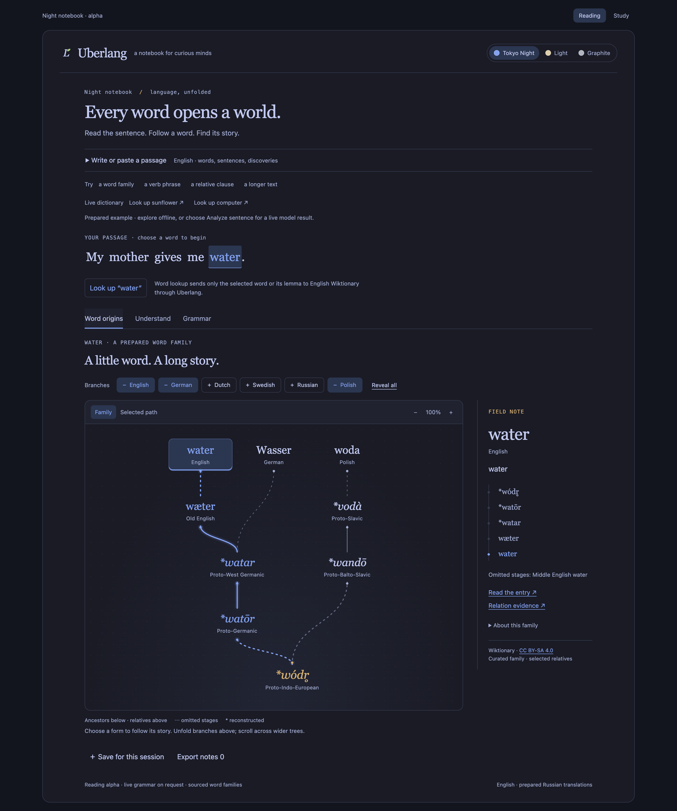
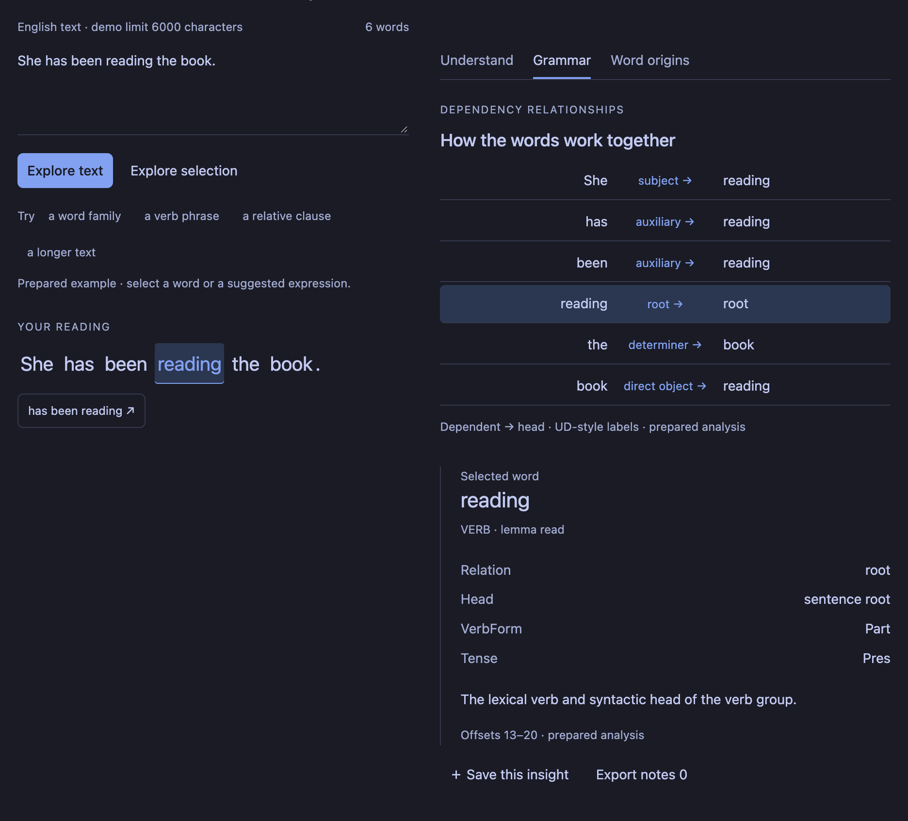

<div align="center">


# Lingua

**Read a sentence. Follow a word. Find its story.**

A language exploration project for meaning, grammar, and word histories.
Built with TypeScript, React, and Electron.

[](https://github.com/Godsdar/Lingua/actions/workflows/ci.yml)
[](https://lingua-lac.vercel.app/concept/)
[](LICENSE)

**[Try the reading concept](https://lingua-lac.vercel.app/concept/)** ·
[Dictionary app](https://lingua-lac.vercel.app/) ·
[Quick start](#quick-start) · [Product specification](docs/PRODUCT_SPEC.md)

</div>

> [!NOTE]
> Lingua is an early personal project. The reading workspace offers **live English grammar analysis**
> alongside three prepared examples. It uses spaCy, a statistical model that can
> make mistakes. Meaning explanations and word families still have limited curated
> coverage. The separate dictionary uses live Wiktionary and translation providers.

## A word’s family

Choose `water` or `mother`, follow its historical path, and reveal related forms
across languages. Each family includes source links and identifies reconstructed
forms and omitted historical stages.

[](docs/assets/concept-family@2x.png)

## A sentence’s structure

Select a word to inspect its lemma, grammatical features, head, and dependency.
Explore an expression or a particular occurrence inside longer text, then save
its explanation and context as a study note.

[](docs/assets/concept-grammar@2x.png)

Both images are fresh **2×, lossless PNG** captures of the actual interface.
Click an image to inspect it at full resolution.

## What works today

| | Dictionary app | Reading concept |
|---|---|---|
| Translation | Live providers, with varying coverage and limits | Prepared English → Russian examples |
| Analysis | Dictionary POS, glosses, alternatives; up to eight unique words | Live English lemmas, features and dependencies; prepared examples available |
| Etymology | Word/translation paths from Wiktionary | Curated `water` and `mother` families |
| Notes | Local roots collection, image export, permalinks | Session notes; downloadable Markdown, JSON, and HTML |
| Interface | Shared React/MUI UI | Reading/Study layouts; Tokyo Night, Light, Graphite |

The concept demonstrates simple syntax, the present perfect progressive, and a
relative clause. Choose **Analyze sentence** to parse your own English sentence. Only that sentence
is sent to Lingua; no third-party inference service is used. Unknown meaning and
etymology remain explicitly unavailable.
Notes are cleared on reload; export first to keep them. JSON ranges use UTF-16
with an exclusive end index. [Workflow and provenance](docs/CONCEPT.md).

## Quick start

**Node.js 24+ and npm.** The concept requires no API key.

```sh
git clone https://github.com/Godsdar/Lingua.git
cd Lingua
npm ci
npm run dev:web
```

Open Vite’s printed URL for the dictionary app; append `/concept/` for the reading
concept. For Electron development, use `npm run dev`.

| Command | Purpose |
|---|---|
| `npm test` | Domain, export, dictionary, and API resilience tests |
| `npm run typecheck` | Desktop, web, and API typechecking |
| `npm run dev:web` / `npm run build:web` | Web development / production output in `web/dist` |
| `npm run dev` / `npm run build` | Electron development / output in `out` |
| `npm run dev:server` | Local Fastify API on `127.0.0.1:8787` |
| `npm run build:server` / `start:server` | Standalone API in `server-dist` / run it |
| `npm run smoke:server` | Verify the built API and graceful shutdown |
| `npm run preview` | Run the built desktop app |
| `npm run build:ext` | Chrome MV3 extension in `extension/dist` |
| `npm run dist:mac` / `dist:win` / `dist:linux` | Desktop installers in `release` |

Load the extension with Chrome’s **Load unpacked** developer option. Desktop
packages are unsigned; signed releases and mobile applications remain future work.

<details>
<summary>Docker and deployment</summary>

```sh
docker build --target web -t lingua-web .
docker run --rm -p 8080:80 lingua-web
docker build --target ci -t lingua-ci .
```

`vercel.json` builds the static web app and concept with `npm run build:web`.
The Vercel demo is published through the CLI. GitHub Pages remains an automatic
mirror with tests and typechecking before publication.
[Deployment instructions](docs/DEPLOYMENT.md).

</details>

## Architecture

```text
src/core/              Browser-compatible dictionary, translation, and tree logic
src/shared/            Shared types and IPC contracts
src/main/              Electron main process
src/preload/           contextBridge adapter
src/renderer/          React/MUI application UI
web/                   Browser adapter and entry
web/concept/           Vite concept entry, typed explorers/domain and styles
src/data/              Shared curated reading examples and sourced families
server/                Node.js 24 + Fastify API, contracts and provider resilience
engine/                Pinned Python/spaCy grammar worker and model tests
api/                   Vercel public gateway and private model entrypoint
extension/             Chrome MV3 popup and context menu
docs/                  Specifications, design, architecture, and decisions
```

One shared core supports web, Chrome, and Electron. The reading workspace keeps input local until explicit analysis. Its typed React
graph explorers consume validated model output with exact token occurrences.
The editor and report controller are still JavaScript; gradual extraction continues.

## Backend foundation

The opt-in API uses **Node.js 24 LTS, TypeScript, and Fastify 5**. It exposes
versioned analysis/translation endpoints, OpenAPI, health checks, strict input
limits, bounded provider concurrency, cancellation, deadlines, and a circuit breaker.
Translation is disabled by default. Production and non-loopback listeners require
a service credential; never put that credential into frontend code.

```sh
npm run dev:server
# In another terminal:
curl http://127.0.0.1:8787/v1/capabilities
```

The public `/api/analysis` gateway calls a private Python worker running
**spaCy 3.8.7 + en_core_web_sm 3.8.0 (MIT)**. It accepts one English sentence
(up to 50 words / 500 UTF-16 units) and exposes no paid translation route.
Prepared explanations and sourced families remain independent of model output.
The gateway is stateless; there are no accounts or persistent server notes.
Vercel Hobby has usage caps and no availability guarantee. See
[the live-analysis decision](docs/decisions/ADR-013-live-grammar-alpha.md).

[Architecture](docs/BACKEND_ARCHITECTURE.md) · [Runbook](docs/BACKEND_RUNBOOK.md) ·
[Backend decision](docs/decisions/ADR-012-node-backend.md)

## Data and privacy

The dictionary app contacts English Wiktionary and translation providers. There
are no accounts or application telemetry; the roots collection stays on the device.
MyMemory is the default translation fallback. Desktop users can configure
`DEEPL_API_KEY` or `LIBRETRANSLATE_URL`; keys must never enter public web or extension
bundles.

Historical concept data credits **English Wiktionary contributors, CC BY-SA 4.0**.
Entry links, relation evidence, and condensed paths are retained in reports.
An asterisk means an unattested reconstruction; similar spelling or meaning alone
does not prove historical kinship. [Data license](https://creativecommons.org/licenses/by-sa/4.0/).

## Roadmap and documentation

Next: linguistically review the statistical parser with pilot readers, expand
sourced families, and add durable local notes.
Branch disclosure, selected-lineage focus, dependency arcs, and reduced-motion-aware
transitions are now implemented in the concept.

- [Product specification](docs/PRODUCT_SPEC.md) and [architecture plan](docs/ARCHITECTURE_PLAN.md)
- [Concept workflow](docs/CONCEPT.md) and [deployment](docs/DEPLOYMENT.md)
- [Architecture decisions](docs/decisions/), [existing design](docs/DESIGN.md), and [graphics](docs/GRAPHICS.md)
- [Interaction design](docs/TREE_AND_ANALYSIS_DESIGN.md), [architecture review](docs/reviews/2026-10-13-architecture.md), and [engine evaluation](docs/ENGINE_EVALUATION.md)
- [First-user launch strategy](docs/LAUNCH_STRATEGY.md)
- [Model implementation playbook](docs/MODEL_PLAYBOOK.md)
- [Contribution guide](CONTRIBUTING.md) and [agent rules](AGENTS.md)
